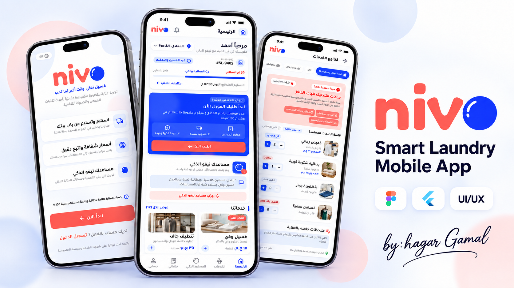
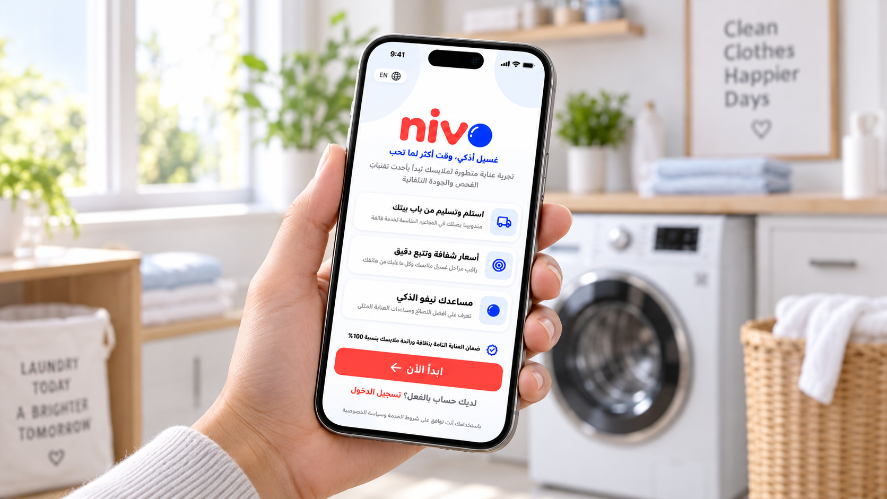
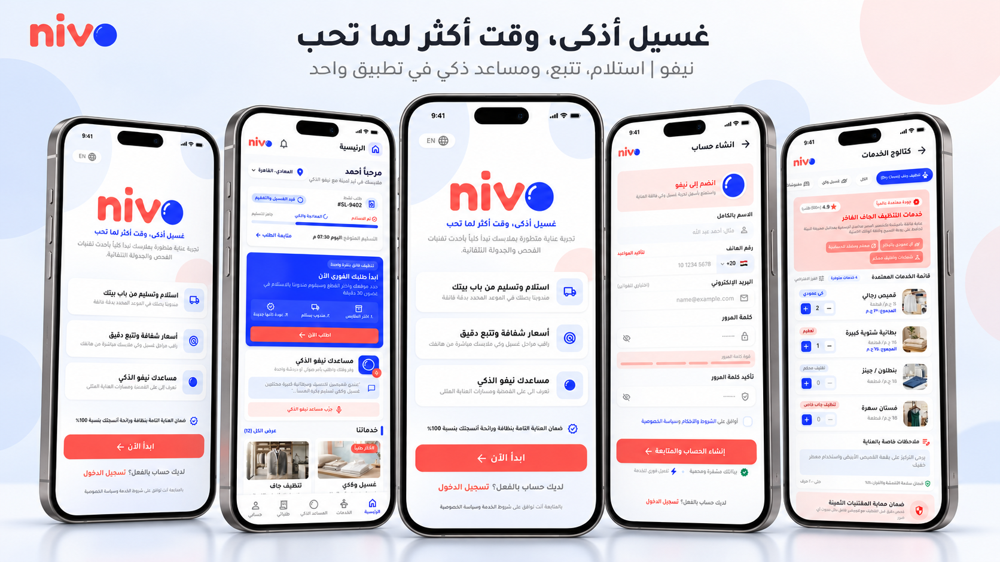

<div align="center">



<br><br>

# NIVO — Smart Laundry App

### Smart Laundry, Smarter Living.

A modern Flutter mobile application designed to make laundry services simpler, smarter, and more convenient.

<br>


</div>

---

## About The Project

**NIVO** is a smart laundry mobile application developed using Flutter and Dart, with a focus on delivering a clean, modern, and intuitive user experience.

The project transforms detailed Figma designs into responsive Flutter interfaces, following a feature-based architecture and reusable widget approach.

The application features an Arabic right-to-left (RTL) interface designed to provide a seamless experience for Arabic-speaking users.

---

## App Preview

<div align="center">

### Welcome Experience



<br><br>

### Application Screens



</div>

> **Note:** The images showcase the Nivo UI/UX design. Some screens and features are still under development.

---

## Key Features

- Modern and intuitive Arabic user interface.
- Right-to-left (RTL) layout support.
- Responsive layouts for different screen sizes.
- Authentication UI (Login, Sign Up, Forgot Password, Reset Password).
- Home dashboard with active order information.
- Order tracking with a multi-step progress indicator.
- Reusable UI components and consistent styling.
- Navigation using GoRouter.
- Feature-based project structure.

---

## Tech Stack

| Technology | Purpose |
|------------|---------|
| Flutter | Cross-platform mobile development |
| Dart | Application development |
| Figma | UI/UX design reference |
| GoRouter | Navigation and routing |
| Flutter ScreenUtil | Responsive UI implementation |
| Git & GitHub | Version control |

---

## Project Structure

```text
lib/
├── core/
│   ├── routing/
│   ├── theme/
│   ├── utils/
│   └── widgets/
│
├── features/
│   ├── auth/
│   ├── home/
│   └── welcome/
│
└── main.dart
```

The project follows a feature-based structure to improve maintainability, scalability, and code reusability.

---

## My Contributions

My development work on NIVO includes:

- Implementing authentication screens using Flutter and Dart.
- Building the Home dashboard interface.
- Creating reusable widgets and UI components.
- Translating Figma designs into responsive Flutter layouts.
- Implementing order status visualization and progress indicators.
- Organizing and maintaining frontend code.

This project originated as a collaborative team project and is now maintained as an independent personal development version.

---

## Getting Started

### Prerequisites

- Flutter SDK
- Dart SDK
- Android Studio or VS Code
- Android Emulator or physical Android device

### Installation

**1. Clone the repository**

```bash
git clone https://github.com/h7agooor2a/Nivo-Smart-Laundry.git
```

**2. Navigate to the project directory**

```bash
cd Nivo-Smart-Laundry
```

**3. Install dependencies**

```bash
flutter pub get
```

**4. Run the application**

```bash
flutter run
```

---

## Development Status

🚧 **Work in Progress**

The project is currently focused on frontend UI development.

Authentication and Home interfaces are being implemented, while backend integration and production functionality are planned for future development.

---

## Developer

<div align="center">

### Hagar Gamal

**Flutter Developer**

Passionate about creating modern, responsive, and user-friendly mobile applications.

<br>

[](https://github.com/h7agooor2a)

</div>

---

<div align="center">

**Built with Flutter 💙**

*NIVO — Smart Laundry, Smarter Living.*

</div>
